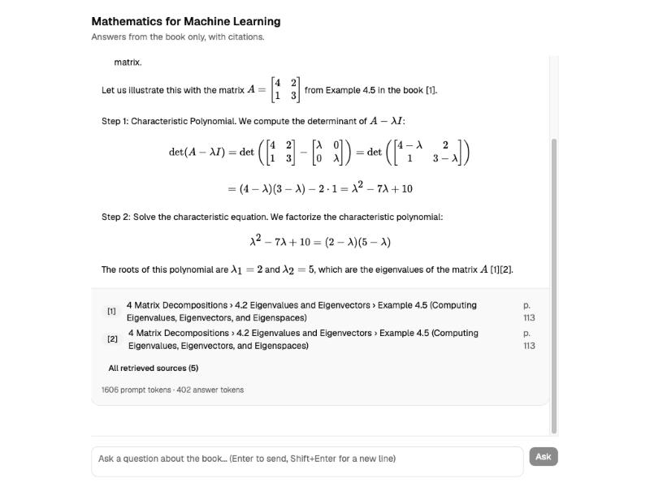
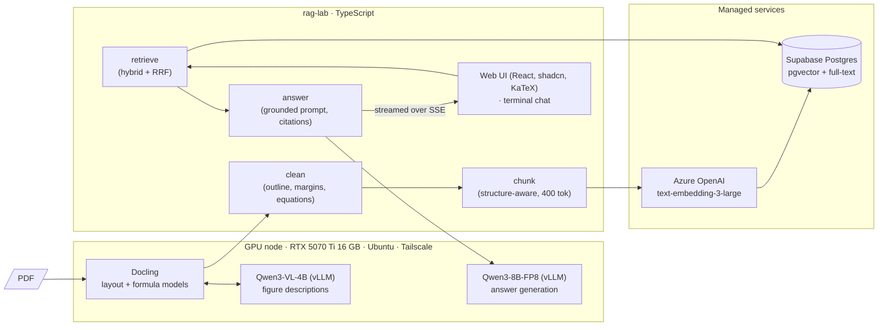

# rag-lab

**A production-shaped RAG pipeline for science-heavy documents, answered by a model running on a single consumer GPU, with every stage measured.**

The test document is *Mathematics for Machine Learning* (Deisenroth, Faisal & Ong): 417 pages of LaTeX-typeset prose, 1,274 equations, 223 figures, margin notes and a two-sided page layout. It's the kind of document where generic "chat with your PDF" demos quietly fall apart. The goal of this lab isn't a demo; it's to find out, stage by stage, **what a small self-hosted setup can actually do, where it breaks, and what the playbook should be** when a client asks for an end-to-end private AI system over their own technical documents.



---

## What it does

Ask a question in a browser or the terminal. The system retrieves the relevant passages from the book with hybrid search, and a local LLM answers **only from those passages**, citing section and page. Math renders as math: matrices, determinants and derivations are typeset with KaTeX.

```
Q: How do you compute the eigenvalues of a 2×2 matrix? Show an example.

det(A − λI) = det([4−λ  2; 1  3−λ]) = (4−λ)(3−λ) − 2 = λ² − 7λ + 10 = (2−λ)(5−λ)
→ λ₁ = 2, λ₂ = 5   [1][2]

[1] 4 Matrix Decompositions › 4.2 Eigenvalues and Eigenvectors › Example 4.5 — p. 113
```

## Architecture



| Stage | Choice | Why |
|---|---|---|
| Parsing | **Docling** on the GPU, formula enrichment on (equations → LaTeX) | Common open-source default for mixed documents; self-hostable; typed document tree with page + bounding box for every item |
| Figures | **Qwen3-VL-4B-FP8** on vLLM, called by Docling as an OpenAI-compatible API | Makes figures retrievable as text; any OpenAI-compatible VLM drops in |
| Cleaning | Own step over Docling's tree; chapters from the **PDF outline** | Parser errors are systematic; one rule per error class beats per-page fixes |
| Chunking | Structure-aware, 400 tokens counted with the embedding tokenizer (`cl100k_base`) | The consensus approach; tool choice matters less than respecting structure |
| Embeddings | **text-embedding-3-large**, shortened to 1,536 dims (Azure, regional deployment) | Fits pgvector's HNSW limit (2,000) at ~2% quality cost |
| Store | **Supabase Postgres + pgvector 0.8** (HNSW) **+ Postgres full-text** (GIN) | One database for vectors, keywords, metadata and permissions; enough for well under ~5–10M vectors |
| Retrieval | **Hybrid**: top-20 vector + top-20 keyword, merged with **reciprocal rank fusion** | The 2026 baseline; no score calibration needed |
| Generation | **Qwen3-8B-FP8** on vLLM, 8,192-token context, streaming | Fully local answer path; swappable for any OpenAI-compatible model without re-embedding |
| Interfaces | Express SSE API, React + shadcn + KaTeX web app, readline terminal chat | Math-heavy answers need real typesetting |

The choices follow a research pass on 2026 practice (frameworks, memory layers, production write-ups, evaluation, security): [docs/rag-state-of-practice-2026](docs/rag-state-of-practice-2026/report.md).

---

## What was measured

### Parsing a 417-page math textbook

| | Result |
|---|---|
| Docling on an M1 MacBook CPU | 3.47 s per prose page; **whole-book job killed by Docker's 7.75 GiB memory cap** |
| Docling on the RTX 5070 Ti, formulas on | **~20 minutes for the whole book**, 3.7 GB VRAM, ~25% GPU utilization (CPU-side work between batches) |
| Elements recovered | 401 headings, 4,990 paragraphs, **1,274 formulas as LaTeX** (394 containing matrices, 0 runaway generations, 1 empty), 223 figures, 18 tables |
| Page furniture | 747 headers and 363 footers labelled by the layout model and excluded |

### Cleaning: systematic errors, one rule each

| Parser error | Fix | Effect |
|---|---|---|
| Equation numbers absorbed into formulas as `( 2 . 1 )` | Extract at row ends, normalize, store as metadata | 202 formulas cleaned; 41 mid-formula numbers left, accepted |
| Footer occasionally labelled as body text | Exact match against strings labelled as furniture elsewhere | 58 leaks removed |
| Margin notes mixed into the text flow | Detect by page geometry, classify as term / note / caption, attach to nearest paragraph | 102 keywords, 205 side notes kept with their paragraph |
| Margin captions not linked to their figure | Link "Figure N.N" captions to the figure on the same page | Captioned figures 90 → 164 |
| Chapter titles extracted without numbers | Use the PDF's own outline (bookmarks) for chapters, front and back matter | Correct section paths everywhere; contents, references and index excluded |

### Figures

A vision model on the same GPU described 67 of 223 figures (Docling skips small images by default). The first deployment failed: with a 60% GPU memory cap, profiling the vision encoder left **0.11 GiB for the KV cache**, less than one request needs. Capping context at 4,096 tokens, concurrency at 4 and memory at 70% fixed it. Descriptions are good at structure and labels, and occasionally invent relationships, so they need spot checks like any parser output.

### Index

1,152 chunks (973 text, 179 figures), median 313 tokens (p10 135, p90 390); 40 exceed the budget because an equation block can't be split. 312k tokens embedded for about **$0.04**.

### Answers: first probes

| Question | Outcome |
|---|---|
| What is an eigenvalue? | ✅ Correct definition and characteristic-polynomial condition, cited to §4.2, pp. 111–112 |
| Compute the eigenvalues of a 2×2 matrix | ✅ Worked example with typeset determinants, cited to Example 4.5 |
| PCA ↔ SVD relationship | ⚠️ Correct core (S = XXᵀ/N, λ = σ²/N, U as eigenvectors), plus **two fluent errors next to valid citations** ("eigenvectors scaled by singular values"; Σ called orthogonal) |
| What is a transformer? (not in the book) | ❌ Acknowledged the gap, then **stretched "linear transformation" into an answer with citations** |

The last two rows are the point: retrieval always returns *something*, and a small model will build a confident bridge from it. That's the failure mode evaluation has to quantify before anything is tuned.

---

## The playbook this is building toward

For an end-to-end private RAG engagement over technical documents:

1. **Discovery first.** Collect real user questions (they become the eval set) and inventory the documents: formats, layout, formulas, tables, noise, access rules.
2. **Parse into structure, then clean the structure.** Pick the parser by testing 2–3 candidates on representative pages; benchmarks disagree. Classify errors as systematic (one rule each) or random (measure, usually accept).
3. **Bespoke per document class, not per document.** Triage the corpus, route each class to a parser tier, catch failures with confidence scores.
4. **Respect structure when chunking**, and carry metadata (section path, pages, keywords) for filtering, weighting and citations.
5. **Hybrid retrieval by default**, keyword weighting on headings, RRF to merge.
6. **Ground and cite**, with an explicit "I don't know" path, and enforce it with a relevance threshold or reranker rather than trusting the prompt.
7. **Measure retrieval and generation separately**, with pass/fail judges validated against human labels.
8. **Keep every model swappable** behind OpenAI-compatible APIs: parser VLMs, embeddings and the answering model are each replaceable without redoing the others.

## What's next

- **Evaluation set**: 20+ hand-written questions with expected sources, including unanswerable ones; recall@5 and MRR for retrieval; pass/fail judges for correctness, grounding and refusal.
- **Refusal guardrails**: relevance threshold and a reranker (Qwen3-Reranker on the GPU) to stop the "stretch" failure.
- **Follow-up questions**: conversation state so "how do I compute it?" knows what "it" is.
- **Baselines**: Docling's own hybrid chunker vs ours; Qwen3-8B vs a frontier model on the same retrieval.

---

## Running it

Requirements: Node 20+, a Supabase project, an Azure OpenAI embedding deployment, and an OpenAI-compatible LLM endpoint (here vLLM on a GPU box reached over Tailscale). Server-side setup for the GPU node lives in a separate repo, [gpu-node-bootstrap](https://github.com/MinoThauros/gpu-node-bootstrap).

```bash
npm install && npm --prefix web install --legacy-peer-deps
cp .env.example .env                 # fill in Supabase, Azure OpenAI and LLM settings
supabase link --project-ref <ref>    # then: supabase db push --linked
```

The book PDF isn't in the repo; download it from the authors' site ([mml-book.com](https://mml-book.com)) into `data/maths_for_ML.pdf`.

| Command | What it does |
|---|---|
| Docling on the GPU node → `out/book.json` | Parse the PDF (see `docs/journal.md` for the exact request) |
| `npm run clean:book` | Clean Docling's output → `out/book.clean.json` |
| `npm run chunk:book` | Chunk → `out/chunks.json` |
| `npm run load:chunks` | Load into Supabase (keyword index filled by trigger) |
| `npm run embed:chunks` | Embed missing or stale chunks (resumable) |
| `npm run search -- "…"` | Inspect hybrid retrieval with both ranks |
| `npm run ask -- "…"` | One answer in the terminal |
| `npm run chat` | Interactive terminal chat |
| `npm run web` | API + web app together → http://127.0.0.1:5173 |

## Repository

```
src/        pipeline (clean, chunk, load, embed, retrieve, answer) and interfaces (chat, web API)
web/        React + shadcn + KaTeX front end
supabase/   migrations: pgvector, documents/chunks, indexes + RLS, hybrid_search(), fts trigger
docs/       research report on 2026 RAG practice, and the lab journal with every step and number
```

The full lab journal, with what was tried, what failed and why, is in [docs/journal.md](docs/journal.md).
